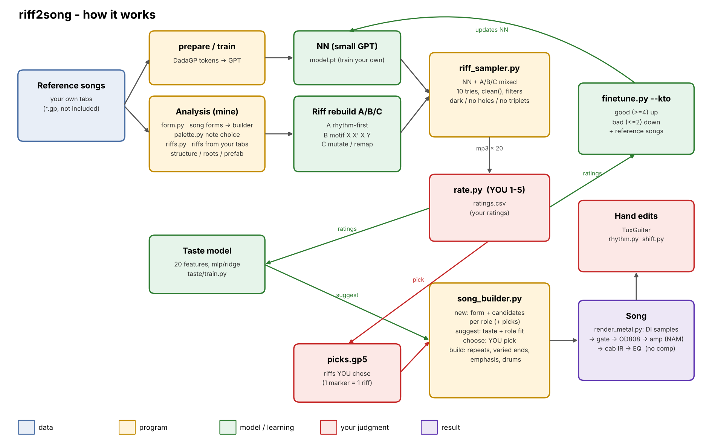

# riff2song

Generate deathcore riffs, rate them, and grow the good ones into full songs, rendered with real DI samples
and amp captures.

> Status: demo / personal research tool. It works, but it expects you to bring your own data
> (reference tabs, the DadaGP dataset) and to spend time rating riffs.

## Demo

A full song built from picked riffs, rendered and mastered with this tool:
**[listen (Releases)](https://github.com/vermiscore/riff2song/releases)** - `riff2song_demo.mp3`



https://github.com/user-attachments/assets/48d23308-ef97-4e31-b47b-c5dc943a85f3


## Concept

Fully automatic song generation sounds monotone. riff2song is built around a different loop:
**the machine proposes, you judge, and the best riffs become songs.**

1. **Riffs, not songs.** The unit is a 2-bar riff. Riffs come from two sources:
   - a small GPT trained on DadaGP tokens (Guitar Pro files as text), fine-tuned on your ratings
   - riffs rebuilt from your own reference tabs (rhythm-first, motif `X X' X Y`, or remapped
     intervals), with rules against "bright" major-key moves, rock cadences, triplets and long holes
2. **You rate them.** Every batch is written as mp3 + gp5, and you score each riff. The ratings feed:
   - **KTO fine-tuning** of the GPT (good / bad, with a reference model so it doesn't forget)
   - a small **taste model** (rhythm, leaps, silence, range ...) used to rank and suggest riffs
3. **Picks.** The riffs you really like go into one `picks.gp5`. This is the most valuable output.
4. **Songs from picks.** `song_builder` takes a song form (intro / verse / pre / chorus / breakdown ...),
   offers your picks plus new candidates for each role, and builds the song: guitar 1 and 2, bass, drums.
5. **Sound.** The guitars are played from real DI samples (palm mutes, up/down picking, string stops),
   then go through a TS808 capture, an amp capture (NAM), a cabinet IR and an EQ. No compression.
   The bass uses real samples too. Optional reference mastering with Matchering.

**Honest note:** the quality comes from your ratings and picks. Expect to rate a few hundred riffs
before the generator feels like yours. The fast route to a good song is: rate a lot, keep only the
best in `picks.gp5`, and build songs from picks.

## What is not included

| Not included | Why | What to do |
|---|---|---|
| Reference songs (gp files) and riffs extracted from them | other people's music | use your own tabs in `refs/` |
| DadaGP dataset | research dataset, no redistribution | request access from the DadaGP authors |
| DadaGP tokenizer code | separate project | clone the DadaGP repository into `nn/dadaGP/` |
| Trained model weights | trained on DadaGP | train your own (`nn/train.py`) |
| Guitar / bass samples | own licences | METAL-GTX and Standard Bass (Unreal Instruments, free) |
| NAM captures, cabinet IRs | own licences | e.g. from TONE3000 (6505 / 6534+, OD808, Peavey 4x12 IR) |

## Setup

```bash
pip install -r requirements.txt          # numpy, scipy, mido, PyGuitarPro, torch ...
# NAM needs pydantic 2: keep it in its own venv so it doesn't touch your main environment
python3 -m venv nn/venv_nam && nn/venv_nam/bin/pip install neural-amp-modeler matchering
```

System tools: `ffmpeg`, `fluidsynth` (fallback sounds), `unrar` (the sample libraries are .rar).

## Workflow

Run everything from the repository root.

### 1. Generate riffs and rate them

```bash
python3 nn/riff_sampler.py --n 20 --src mix                            # 20 riffs: NN + rebuilt
python3 taste/rate.py --run $(ls -t outputs | grep _riffs | head -1)   # listen and rate
```

### 2. Learn from the ratings

```bash
python3 nn/finetune.py          # plain fine-tune on well-rated riffs
python3 nn/finetune.py --kto    # KTO: also learns from the bad ones (do this every few batches)
python3 taste/train.py          # taste model used for ranking / suggestions
```

### 3. Keep the best ones

```bash
python3 nn/riff_sampler.py pick 3 12 --to ../tabs_picks/picks.gp5     # riff numbers from the last batch
```

Repeat 1-3. The picks file grows; each riff is stored with a marker so you can open it in Guitar Pro.

### 4. Build a song from your picks

```bash
python3 nn/song_builder.py new --form <reference song name>   # form + candidates per role (mp3)
python3 nn/song_builder.py suggest --apply                    # or choose yourself:
python3 nn/song_builder.py choose INTRO=p2 V=3 PRE=1 CH=p5 BD=4 BR=2
python3 nn/song_builder.py build                              # song.gp5 / song.mid / song.mp3
```

`pN` = riff N of your picks, a plain number = a new candidate. Chosen new candidates are recorded as
rated 5, so they feed the next fine-tune.

Small edits in Guitar Pro are fine. Helpers: `nn/rhythm.py` (change rhythms), `nn/shift.py` (shift frets).

### 5. Render

Put the paths once into `nn/amp_settings.json` (see `nn/amp_settings.example.json`, key `"render"`),
then:

```bash
python3 nn/render_metal.py works/song.gp5
```

or everything on the command line:

```bash
python3 nn/render_metal.py works/song.gp5 \
  --di samples/UI_METAL-GTX --bass-di samples/Ui_Standard_Bass_V2 \
  --nam "samples/6534/<amp capture>.nam" --nam-pre samples/od808/OD808_6505+.nam \
  --ir samples/ir_peavey/412MS_SHF_mix_57+57.wav --gate -45 --tight 150
```

Chain per guitar: DI samples -> low cut (`--tight`) -> noise gate (`--gate`) -> OD808 -> amp -> cab IR
-> EQ. Guitar 2 is a second take (other samples, slight timing spread), panned opposite.
Optional drums from a DrumGizmo kit: `--drumkit DIR`.

### 6. Master (optional)

```bash
nn/venv_nam/bin/python -c "import matchering as mg; mg.process(target='works/song.wav', \
  reference='ref.wav', results=[mg.pcm24('works/song_master.wav')])"
```

## Licence

Code: MIT. Samples, captures, IRs and datasets keep their own licences and are not part of this repository.
